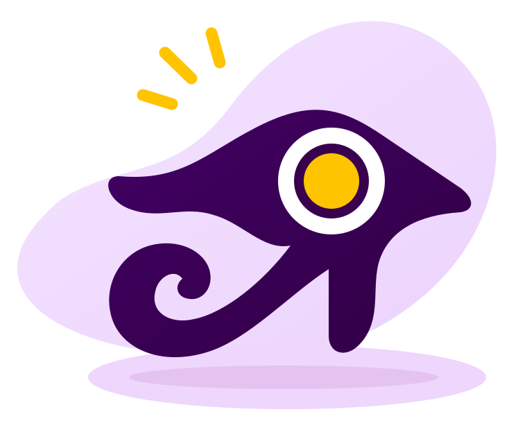

# Pocket Guide de Acessibilidade

  

## Sobre o projeto

O Pocket Guide de Acessibilidade é um guia prático desenvolvido pelo Grupo 09 da disciplina de Interação Humano-Computador da Universidade de Brasília (UnB), no semestre 2026.2.

O projeto reúne perguntas de verificação e recursos para apoiar a criação e a avaliação de produtos digitais acessíveis. A documentação é organizada por áreas de atuação e publicada com MkDocs e Material for MkDocs.

## Conteúdo do guia

- [Desenvolvimento Web](docs/devWeb/non_text_content.md): teclado, navegação, interação, formulários, estrutura e tecnologias assistivas.
- [Design](docs/design/design.md): apresentação visual, contraste, adaptação de tela e legibilidade.
- [Geração de Conteúdo](docs/geracaoConteudo/conteudo.md): alternativas textuais, mídias, linguagem e clareza da comunicação.
- [Gestão de Projetos](docs/gestaoProjeto/gestaoProjeto.md): planejamento, participação de pessoas com deficiência e avaliação da acessibilidade.
- [Ferramentas de Acessibilidade](docs/tools/ferramentas.md): recursos de apoio à verificação e aos testes.

As perguntas estão consolidadas em [perguntas.md](perguntas.md), com referências ao Guia de Boas Práticas para Acessibilidade Digital do Ceweb.br, às WCAG 2.2 e à ABNT NBR 17225:2025.

## Como usar

Escolha uma área do guia e percorra o checklist conforme o conteúdo ou produto avaliado. Marque cada item atendido e registre os que ainda precisam de ajustes. Quando uma pergunta não se aplicar, indique “N/A” ao lado.

## Equipe

<table>
  <tr>
    <td align="center"><a href="https://github.com/felipemso"> <strong>Felipe Melo</strong></a></td>
    <td align="center"><a href="https://github.com/Marctroman"> <strong>Marco Antônio</strong></a></td>
    <td align="center"><a href="https://github.com/CharlesRuan-MAP"> <strong>Charles Ruan</strong></a></td>
    <td align="center"><a href="https://github.com/Mateiki"> <strong>Matheus Eiki</strong></a></td>
  </tr>
  <tr>
    <td align="center"><a href="https://github.com/G2SBiell"> <strong>Gabriel Portácio</strong></a></td>
    <td align="center"><a href="https://github.com/giovannabrito19"> <strong>Giovanna Aguiar</strong></a></td>
    <td align="center"><a href="https://github.com/kaikysousa"> <strong>Kaiky Dourado</strong></a></td>
  </tr>
</table>

## Licença

Consulte os termos de uso e distribuição em [LICENSE.md](LICENSE.md).
